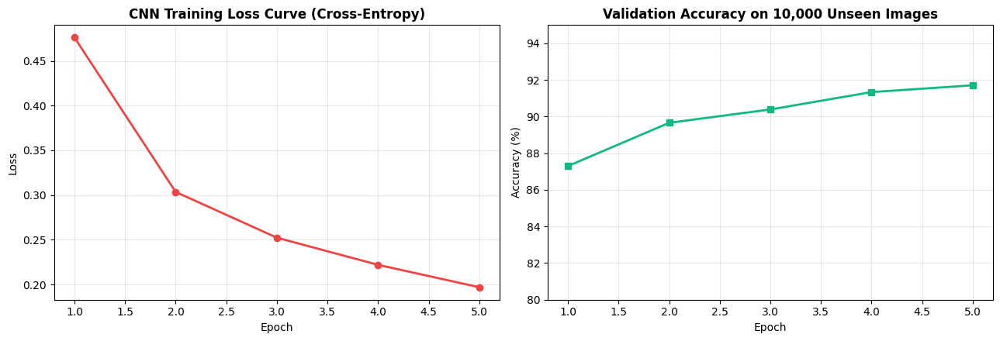
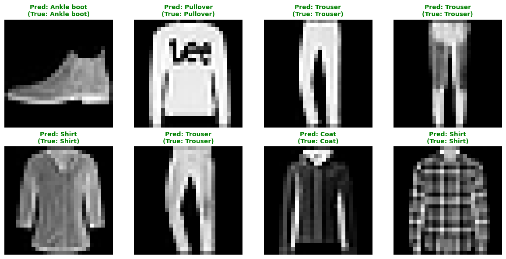

# 🧠 Deep Learning Image Classifier (PyTorch CNN)

**Developed by:** Nayyab Faisal  
**Focus Areas:** Deep Learning, Convolutional Neural Networks (CNNs), Computer Vision (`PyTorch`)

---

## 📌 Project Overview
This project implements a custom **Convolutional Neural Network (CNN)** from scratch in **PyTorch** to classify 70,000 grayscale images across 10 apparel categories from the **Fashion-MNIST** benchmark dataset (`60,000` training images and `10,000` unseen test images).

---

## 🏗️ Neural Network Architecture & Training
* **Feature Extractor:** Two convolutional blocks (`Conv2d` 1→32 and 32→64 channels, `3×3` kernels) with `ReLU` activations and `2×2` `MaxPool2d` downsampling.
* **Classifier Head:** Fully connected dense layers (`3136 → 128 → 10`) with `Dropout (0.25)` regularization to prevent overfitting.
* **Optimization:** Trained over 5 epochs using **Adam optimizer** (`lr=0.001`) and **Cross-Entropy Loss**.

---

## 📊 Training Performance & Sample Predictions

---

## 🛠️ Tech Stack
* **Deep Learning Framework:** PyTorch (`torch`, `torchvision`)
* **Visualization:** Matplotlib
* **Environment:** Google Colab & GitHub
